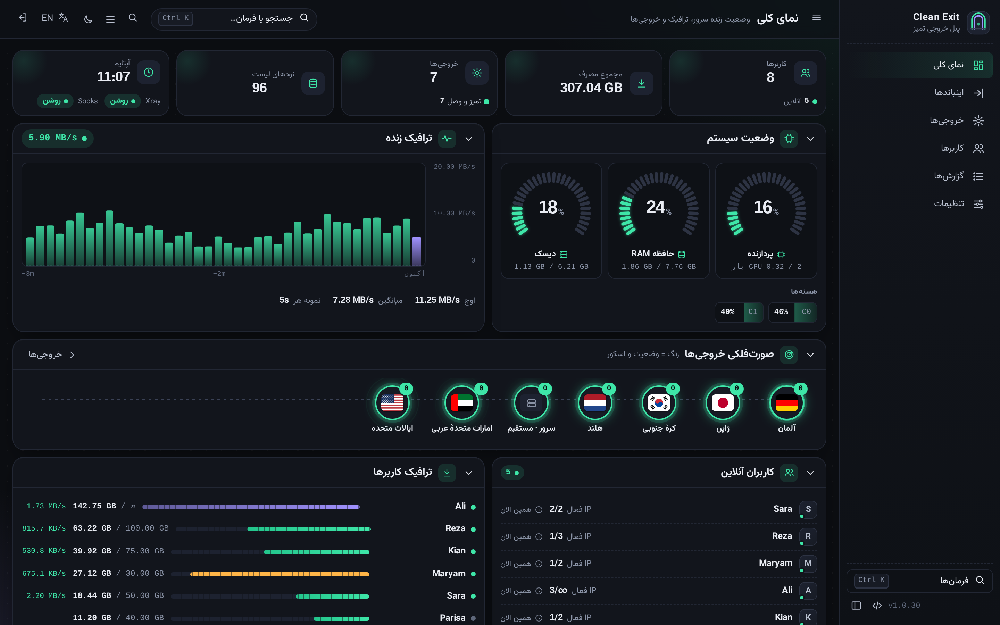
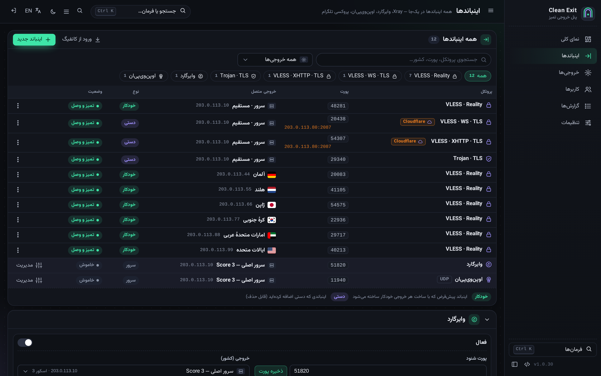
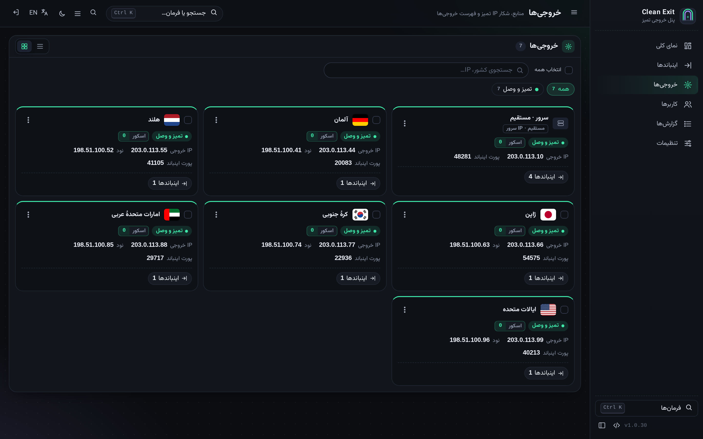
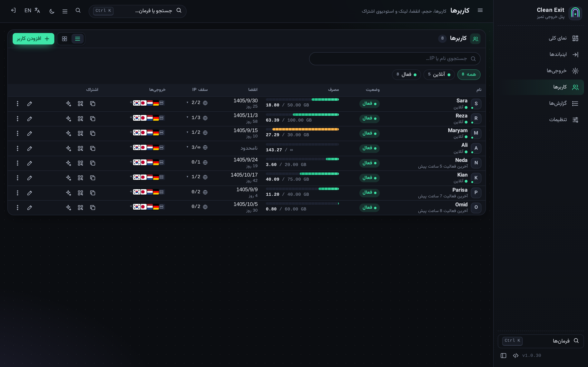
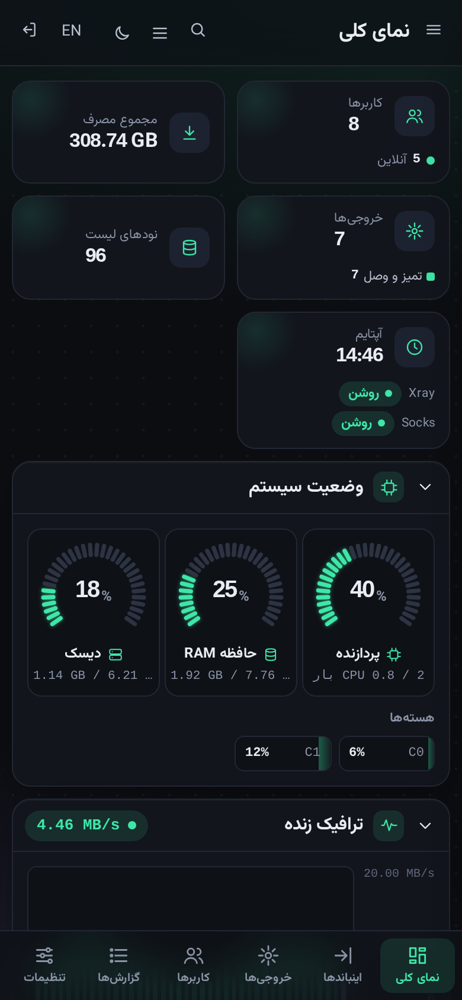
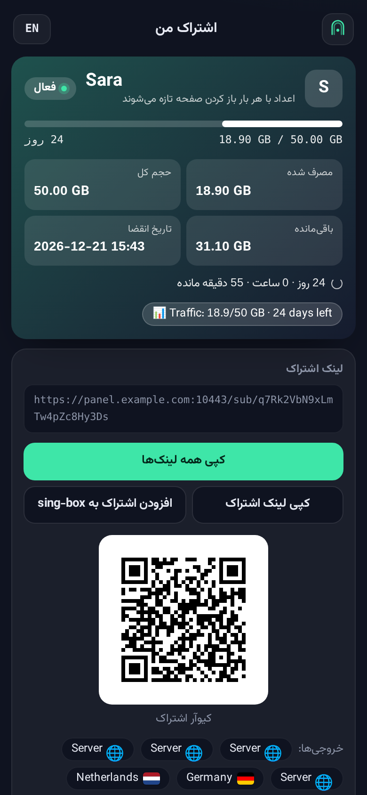

# CleanPanel

CleanPanel is an all-in-one, self-hosted server management panel with a web dashboard for managing users, traffic and services on your own server.

Current version: **v1.0.30**

📖 [نسخه فارسی](docs/README-fa.md)

## Features

- **Multiple locations from one VPS**: clean exits in many countries from a single server
- **Telegram proxy** with sponsored proxy support
- **OpenVPN** and **WireGuard** support
- User management: create, edit, enable, disable and remove users
- Traffic and quota management per user
- Time limits and expiry dates per user
- Inbound management: create, edit and remove inbounds
- Subscription management for users
- Announcements for users from the dashboard
- Cloudflare inbounds (WebSocket and XHTTP/TLS)
- Create an inbound from a link
- Modern web dashboard with traffic statistics

## Support / Donations

If CleanPanel is useful to you, donations are welcome and completely voluntary. They help with development and maintenance.

- Wallet address (TRC20): TBpfUztumvm2GQnYLFbL2LXwCXBThDZyVF
- Telegram: [@chicken_amen](https://t.me/chicken_amen)

## Requirements

- Your own server (VPS or dedicated server)
- Ubuntu 22.04 or Ubuntu 24.04
- Root or sudo access
- A domain name pointing to your server (recommended, for TLS)

## Install

One-line install:

```bash
curl -fsSL https://raw.githubusercontent.com/CleanPanel/CleanPanel/main/install.sh | sudo bash
```

See [docs/INSTALL.md](docs/INSTALL.md) for install options (with a domain, custom port) and manual installation.

After install, open the panel URL printed by the installer and choose the admin password on the setup page.

## Update

See [docs/UPDATE.md](docs/UPDATE.md) for the full update flow, and `update.sh` for a helper script.

Short version:

1. Check the [Releases](../../releases) page for the latest version.
2. Download the new binary.
3. Stop the panel service, back up the current binary, replace it, and start the service again.
4. Verify the version in the dashboard.

## Screenshots













More screenshots (settings, command palette, Cloudflare CDN editor, mobile inbounds, English UI) are in [docs/screenshots/](docs/screenshots/). All screenshots use demo data.

## Security

- Never share your admin credentials, API tokens or server addresses in public issues.
- Keep your server and the panel updated to the latest release.
- Use TLS (HTTPS) for the dashboard.
- See [SECURITY.md](SECURITY.md) for how to report a security issue.

## FAQ

**Do I need a domain?**
A domain is recommended so the dashboard can use TLS, but the panel can also run on an IP address.

**Which operating systems are supported?**
Ubuntu 22.04 and Ubuntu 24.04 are supported.

**Where do I get the latest version?**
From the [Releases](../../releases) page of this repository.

**How do I report a bug?**
Open an issue in this repository with the panel version, your operating system, and the steps to reproduce the problem. Do not include credentials, tokens or server addresses.

## Changelog

See [CHANGELOG.md](CHANGELOG.md).

## License

CleanPanel is released under the MIT License. See [LICENSE](LICENSE).
