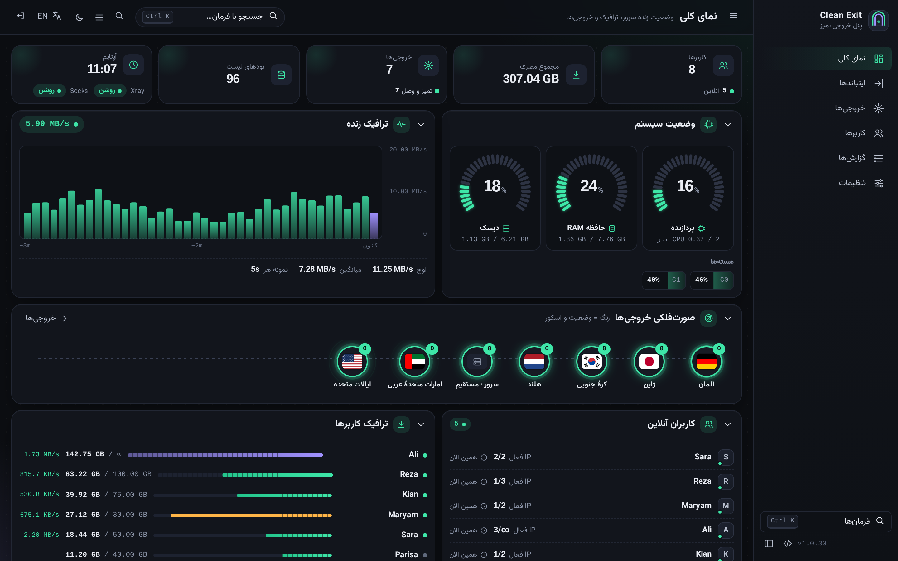
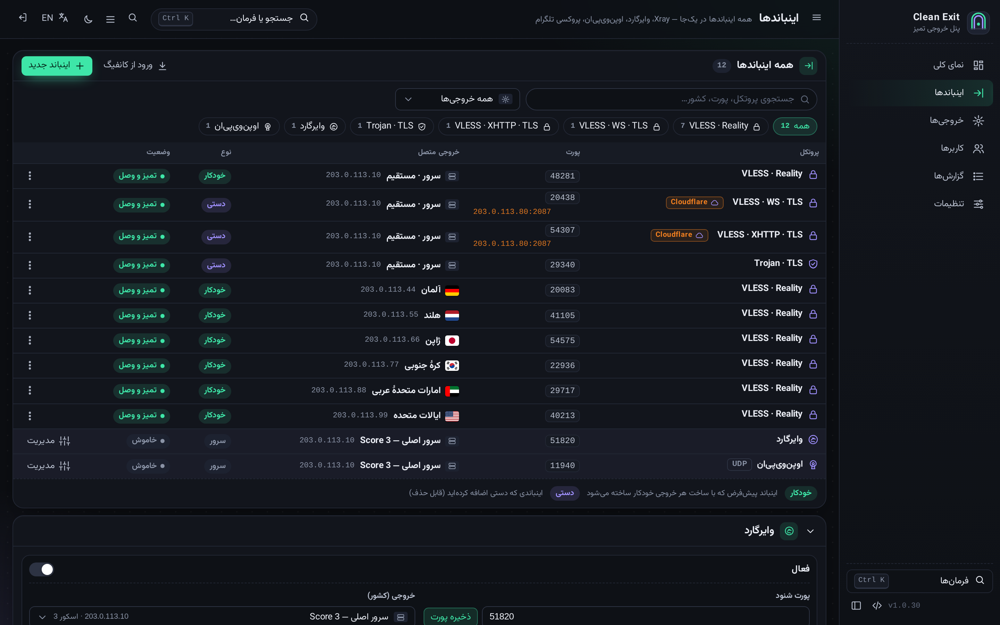
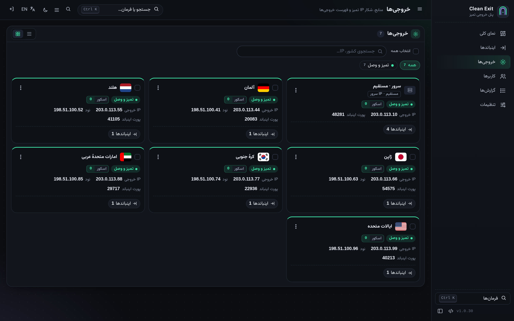
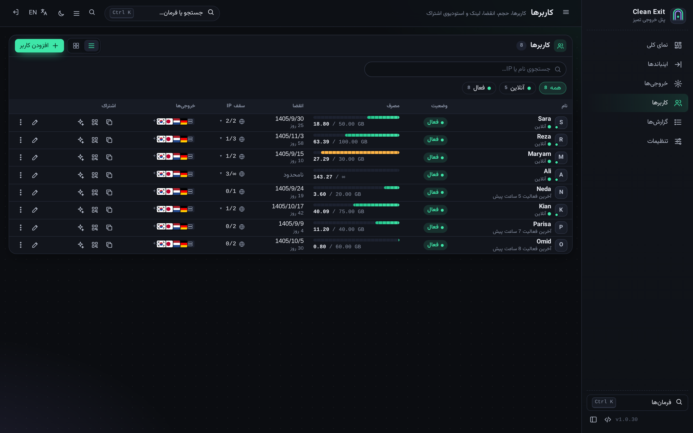
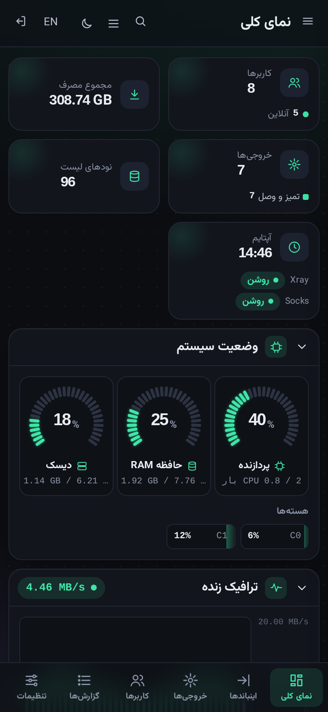
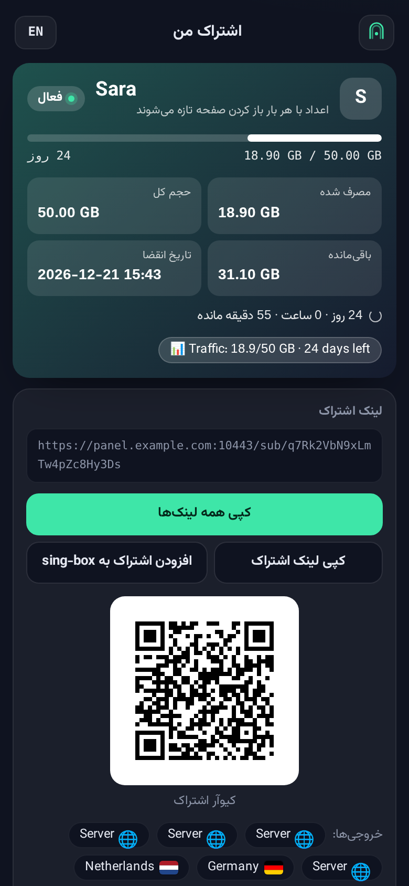

# CleanPanel

CleanPanel یک پنل همه‌کاره است که روی سرور خودتان نصب می‌شود و با یک داشبورد وب، مدیریت کاربرها، ترافیک و سرویس‌ها را انجام می‌دهد.

نسخه فعلی: **v1.0.30**

📖 [English version](../README.md)

## امکانات

- **چند لوکیشن با یک VPS**: خروجی‌های تمیز در چند کشور، فقط با یک سرور
- **پروکسی تلگرام** با پشتیبانی از اسپانسر پروکسی
- پشتیبانی از **OpenVPN** و **WireGuard**
- مدیریت کاربرها: ساخت، ویرایش، فعال و غیرفعال کردن و حذف کاربر
- مدیریت ترافیک و حجم هر کاربر
- محدودیت زمانی و تاریخ انقضا برای هر کاربر
- مدیریت اینباندها: ساخت، ویرایش و حذف اینباند
- مدیریت اشتراک کاربرها
- اطلاعیه برای کاربرها از داخل داشبورد
- اینباندهای Cloudflare (WebSocket و XHTTP/TLS)
- ساخت اینباند از روی لینک
- داشبورد وب مدرن با آمار ترافیک

## حمایت مالی

اگر CleanPanel برای شما مفید است، حمایت مالی کاملاً داوطلبانه است و به توسعه و نگهداری آن کمک می‌کند.

- آدرس ولت (TRC20): TBpfUztumvm2GQnYLFbL2LXwCXBThDZyVF
- تلگرام: [@chicken_amen](https://t.me/chicken_amen)

## پیش‌نیازها

- سرور شخصی خودتان (VPS یا سرور اختصاصی)
- اوبونتو ۲۲٫۰۴ یا ۲۴٫۰۴
- دسترسی روت یا sudo
- دامنه‌ای که به سرور شما اشاره کند (توصیه می‌شود، برای TLS)

## نصب

نصب با یک دستور:

```bash
curl -fsSL https://raw.githubusercontent.com/CleanPanel/CleanPanel/main/install.sh | sudo bash
```

گزینه‌های نصب (با دامنه، پورت دلخواه) و نصب دستی در [docs/INSTALL.md](INSTALL.md) آمده است.

بعد از نصب، آدرس پنل را که اسکریپت چاپ می‌کند باز کنید و در صفحه راه‌اندازی رمز مدیر را انتخاب کنید.

## به‌روزرسانی

روش کامل به‌روزرسانی در [docs/UPDATE.md](UPDATE.md) آمده است و `update.sh` هم یک اسکریپت کمکی است.

خلاصه:

1. صفحه [Releases](../../releases) را برای نسخه جدید بررسی کنید.
2. باینری جدید را دانلود کنید.
3. سرویس پنل را متوقف کنید، از باینری فعلی بکاپ بگیرید، آن را جایگزین کنید و سرویس را دوباره اجرا کنید.
4. نسخه را در داشبورد بررسی کنید.

## اسکرین‌شات‌ها













اسکرین‌شات‌های بیشتر (تنظیمات، کامند پلت، ویرایشگر CDN کلادفلر، اینباندهای موبایل، رابط انگلیسی) در [docs/screenshots/](screenshots/) آمده است. همه اسکرین‌شات‌ها با داده نمایشی گرفته شده‌اند.

## امنیت

- اطلاعات ورود مدیر، توکن‌های API یا آدرس سرور را در ایشوهای عمومی به اشتراک نگذارید.
- سرور و پنل خود را همیشه به‌روز نگه دارید.
- برای داشبورد از TLS (HTTPS) استفاده کنید.
- نحوه گزارش مشکل امنیتی در [SECURITY.md](../SECURITY.md) آمده است.

## سوالات متداول

**آیا دامنه لازم است؟**
دامنه توصیه می‌شود تا داشبورد بتواند از TLS استفاده کند، ولی پنل با آدرس IP هم کار می‌کند.

**کدام سیستم‌عامل‌ها پشتیبانی می‌شوند؟**
اوبونتو ۲۲٫۰۴ و ۲۴٫۰۴ پشتیبانی می‌شوند.

**آخرین نسخه را از کجا بگیرم؟**
از صفحه [Releases](../../releases) همین ریپو.

**باگ را چطور گزارش کنم؟**
در همین ریپو یک ایشو باز کنید و نسخه پنل، سیستم‌عامل و مراحل بازتولید مشکل را بنویسید. اطلاعات ورود، توکن یا آدرس سرور را ننویسید.

## تغییرات

در [CHANGELOG.md](../CHANGELOG.md) ببینید.

## لایسنس

CleanPanel با لایسنس MIT منتشر شده است. [LICENSE](../LICENSE) را ببینید.
